    <h3> 👋 HELLO! 😁️ </h3>
    <i>I am</i>
    <h1> Dmitri Viggo Barks&emsp;J. M. </h1>
    
 &emsp;
 &emsp;
 &emsp;
 &emsp;

    
3rd Year College student enrolled in a Computer Engineering program in the Philippines striving to break into Embedded Software Engineering, Firmware Engineering, or Embedded Systems, or areas similar to those.
 

  <h3>Currently Working On</h3>
  

---

    <h3> Known Programming Languages </h3>

 &emsp;
 &emsp;

 
    <h3> Known Microcontroller Development Frameworks </h3>

 &emsp;
 &emsp;

 
    <h3> Currently Learning and Interested In</h3>

 &emsp;
 &emsp;
 &emsp;
 &emsp;

---

    <h4> 🤓☝️ Fun Fact 🤓☝️</h4>
I have 7 pet dogs  💙️

---

 

# Contact Me
- Gmail: [dmitriviggomajorenos.business@gmail.com](dmitriviggomajorenos.business@gmail.com)
- Facebook: [https://www.facebook.com/dmitriviggobarks](https://www.facebook.com/dmitriviggobarks)
- Instagram: [https://www.facebook.com/dmitriviggobarks](https://www.facebook.com/dmitriviggobarks)
